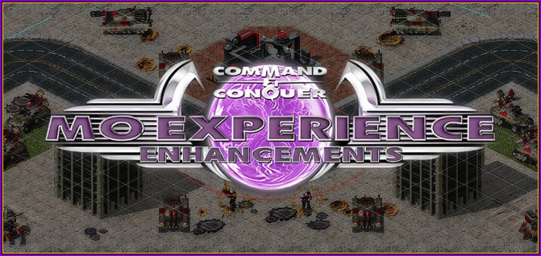

# 心灵终结体验优化拓展
[本项目](https://github.com/MagicShiba/MO_ExperienceEnhancements)旨在提高《[心灵终结](http://mentalomega.com/)》的游戏体验，修复游戏bug。  
在为游戏添加更多新的功能、减少操作复杂性的同时，坚持做到不影响联机功能。  
不涉及任何游戏内ini修改。  
支持版本：3.3.6 ，理论上也兼容使用相同 ares 的mod。  
你可以在联机pve中使用，但不要用于PVP，这不在预期内，我不对玩家抱有恶意，但用于pvp将会自动重复告知其他玩家在作弊。  

## 当前项目做了什么?
这里是简要说明，[查看更详细的功能演示和说明](docs/功能展示-UI篇.md)  

| 更好的文本显示 | 建筑功能 |
| -- | -- |
| 居中，持久，随时查看的战役文本，不再挤压战役文本。 操作信息踢出主要文本，和雷达事件单独显示，点击跳转事件 修复输入法位置错误问题，更好的输入框和可自定义预设文本。 可自定义文本字体和显示大小。 | 建造队列，建造位置预览， 建造时驱离单位 折线集结点(生产建筑路径点) 快速维修(双击或自动) |

| 侧边栏 | 底栏 |
| -- | -- |
| 可自定义的超武侧边栏，获得干净的防御栏 隐藏侧栏，全屏或只显示雷达(提供触发支持) 快速跳转翻页的滚动条 电力状态显示 | 缩放画面，细看或更广阔的视野，可显示全图 暂停和帧进，逐帧下令 网格显示，查看不可建造或通行 无ui截图，可配合缩放截取全图 |

| 摆基地截图大加强！ | 许愿集大成之处！ |
| -- | -- |
| 添加详细的**环境控制功能** 云朵雾气投影，光照控制，雨雪天气控制 你可以调整过于黑的地图光照(旧版心血结晶)。 可以缩放，暂停，无UI截图(包含天气) 甚至通过**缩放**在游戏内直接原分辨率截取整张地图！ 你可以调节自己的颜色，甚至彩虹色！ 无ui截图，隐藏侧栏更大区域截图 | **信息面板区域** 选中战机时可显示弹药，不用切换屏幕查看了 显示单位血量、经验值、加成信息 从多组单位中选中某一类型单位 选中载具时显示载员内容 单独卸载某一成员，而不是全部下车，也支持建筑 从载具中下达路径点 |
| **小窗口功能**  | **边缘按钮**  |
| 支持自动跳转事件。(对应空格跳转的雷达事件) 支持远程下令，可在小窗中查看和操作其它区域(如致命冲击) 支持无焦点跟随(按F,但不会因取消丢失目标)  | 收藏功能，并带有箭头指示，可设中心显示或边缘显示 也支持显示通讯信标位置 wasd移动功能，可用于单兵作战  |

| 游戏控制与界面优化杂项 | |
| -- | -- |
| 更细粒度的游戏速度调节  | 存档时也储存一份屏幕截图，易于区分游戏  |
| 心控单位过滤  | 解除128操作限制  |
| 侵略模式，自动攻击范围/警戒区域敌人  | 解除路径点16/128限制  |
| 简化移动攻击，允许自定义快捷键  | 解除500显示时框选上限  |
| 修复T键对单位难以生效  | 飞行器支持路径点  |
| 攻击命令过滤无攻击单位  | 修复地图小于视图时显示抖动  |
| 可禁用心控来的单位损失提示  | 修复读档后观战失效和任意AI被击败后游戏结束  |
| 查看箱子类型，基本只支持战役 (随机箱子不支持) | 在战役结束添加退出游戏 (因继续下一关在有些战役会卡触发和状态)  |
| 支持光照混合切换 (默认光照，和触发光照切换)  | 修复cncddraw导致设置界面占用cpu过高问题 修复光照变化和读档光照问题，支持矿石亮度调节 |
| 自动删除旧信标和解除单机信标限制  | 局部选中单位欢呼，而非全局欢呼  |

**模糊下令 (也叫智能中键，但可修改快捷键)**
- 中键点击移动，空军分散寻位，陆军聚团螺旋排列，便于铁幕之类使用
- 中键划战线移动，快速简单阵型，分配到线上
- 中键巡逻圈，z+中键点击自动建立小巡逻圈，拖动快速建立巡逻圈
- 基地车类单位展开预览，划线分配位置，自动展开，shift强制直线。
- 自动砍树，ctrl + z + 中键，不需要点到树上。
- 快速自动选择目标，shift + 中键 ，批量进驻，批量占领，批量维修，坦克进碉堡等 
- 模糊下令快速选择目标，ctrl+中键点击，针对蜘蛛之类的难选单位(生态位基本被shift+中键占了，最初没计划太强...)

为了尽快发布第一版，让大家能够体验到新功能，因此有些已知的细节小bug暂时没有修复。  
有些在回复中的功能暂未实现。  

### 自动装车在哪？
查看项目：[自动装车](https://github.com/MagicShiba/MO_AutoLoad)  
目前不打算合并。

## 使用说明
将 `MOExperience.dll`、`MOExperience.ini` 与 `MOExperienceResources` 文件夹放在游戏根目录内。

### 功能配置
游戏内按下ESC键，即可显示扩展的设置菜单（这并非全部）。  
在 `MOExperience.ini` 中写了详细的使用说明，详细的配置可修改此文件。  
快捷键配置可参考`Hotkey.md`。  
自定义超武排序，将喜欢的放在前面，可参考`超武列表.md`和配置文件中的例子，目前默认将铁幕，立场护盾放在了前面。

## 开发与构建

查看项目：[自动装车](https://github.com/MagicShiba/MO_AutoLoad)  
在说明中简要说明了如何开发这类插件。

环境：
- 环境：`mingw-i686`
- 构建脚本：build-fast.bat
- 全量构建：build-full.bat

未在项目中列出的文件夹：  
参考文件夹 即 phobos,yrpp,临时地图等参考  
ini文件夹 即 rulesmo.ini等、ini查询文档、单位名等scf表、地图参考

## 计划
x类红三和将军的技能选择和单位信息显示-显示经验血量精确值,命令指示,能力槽位  
x补充信标功能,信标菜单,快速选择文本  
x副官辅助小操作功能,或许是新项目  
x渲染上GPU优化  
x实现回放功能和添加内部列表  

## 赞助 tokens
### -> [赛博乞讨](https://github.com/MagicShiba/MO_ExperienceEnhancements/blob/master/docs/赛博乞讨.md)

## 笔记(notes)
由AI编写的功能实现原理，踩坑记录，注意事项等。  
这基本不是给用户看的。

## 参考项目
[phobos](https://github.com/Phobos-developers/Phobos) ：一个强大的扩展。  
[yrpp](https://github.com/Ares-Developers/YRpp) ：提供与 C++ 引擎补丁/扩展中的 Yuri's Revenge 引擎交互的能力。

## 相关项目
[红警2字体编辑器](https://github.com/MagicShiba/Ra2FontEditor)