# 功能展示文档-GUI
本文档更详细直观的介绍插件的功能。  
注：为避免篇幅太长，这里介绍演示的是UI功能示例。配置会有省略以节约空间，详细查看配置文件。

查看更多：  
[2.杂项更改与模糊下令](2.杂项更改与模糊下令.md)   
[3.环境控制](3.环境控制.md)  
[4.游戏控制与杂项](4.游戏控制与杂项.md)

你可以在**设置页**快速更改一些功能，但细节调整可能仍然需要修改配置文件。  
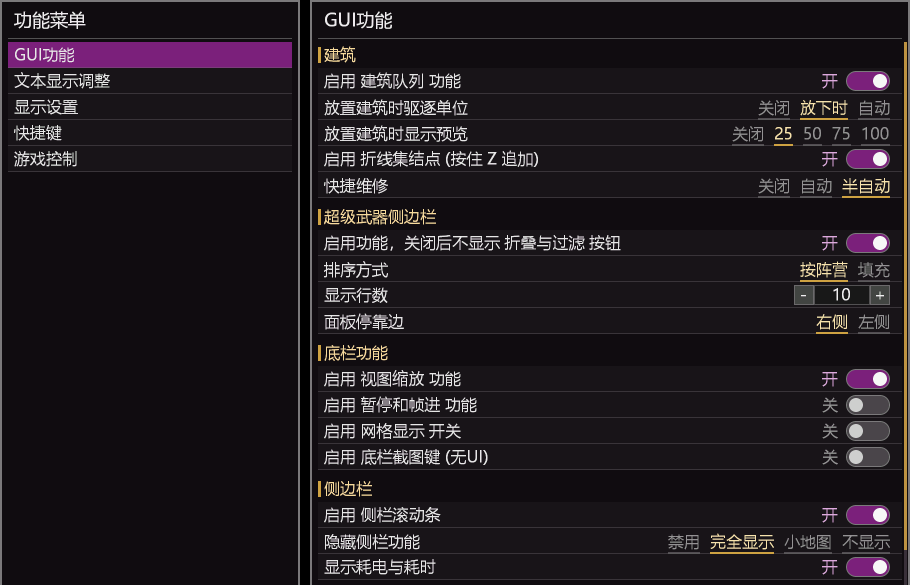


# 新增的GUI功能
## 建筑相关
### 建筑队列
建筑建造队列，通过模拟玩家操作实现。  
不进入存档，在联机中使用会有轻微延迟。  
这是因为标准队列是联机同步的，没有延迟，而模拟玩家操作会有延迟。  
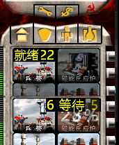

### 建造时驱赶单位
分为自动驱逐和手动驱逐。  
如果你使用快捷键放置建筑，那么可以用自动驱逐。  
如果你不想被意外驱逐单位，那么可以用手动驱逐。
```
[PlaceScatter]
Mode=1		; 0=禁用(原版行为), 1=点下时驱离(默认, 晃幽影不碰单位), 2=幽影跟随自动驱离
Interval=30	; Mode=2 补扫间隔 (游戏逻辑帧, 5~300, 默认30)
Batch=16	; 每次触发最多发出的移动事件 (1~64, 默认16)
Dist=2		; 出框后再向外推的格数 (1~4, 默认2)
```
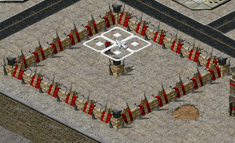

### 建筑放置和展开预览
建筑物方式时显示虚影预览，可配置透明度，对可展开单位有效，可以在缩放模式下使用。
```
[PlacementPreview]
Opacity=25
```
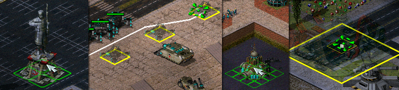

### 生产建筑折线路径点
支持工厂按Z设置复杂聚集点。可用于规避威胁。  
本质靠路径点实现，比较鸡肋。  
与玩家操作存在一些冲突，因为路径提交是全局的，在玩家进入路径模式时，单位会等待。  
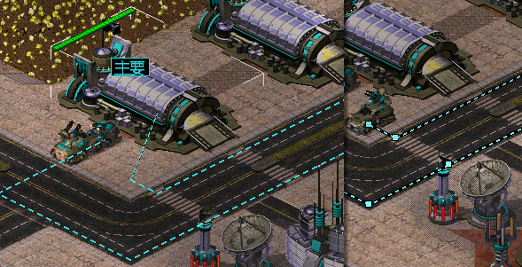

### 简化建筑维修
默认启用的是快速维修，不是自动维修。  
Ctrl+维修 或 双击维修。  
快捷键或界面按钮均可。  
也支持自动维修。  
扩展中做了维修过滤，不能维修其它不该被维修的东西。  

## 超武侧栏列表
可自定义排序，将喜欢的超武放在前面。  
目前默认将力场护盾和铁幕排在前面，使用超武名称和优先级进行排序。  
可折叠，不占用空间；可隐藏防御支援页面超武，从而达到干净的防御页面。  
默认按阵营分列（盟/苏/厄/焚风各一列），可在显隐箭头上右键切换为“填充式”：排序不看阵营，各列高度尽量均衡，先两列、不够再依次加到三/四列，满四列才滚动，从而减少翻页。   
可设置显示**行数**，或者因为超武列表太多而显示在**左侧**。
```
[SWSidebar] ;配置参考，有省略。
ToggleKey=F4		; 切换显示/隐藏。隐藏时既不画也不占空间。语法见 Hotkey.md
Alpha=75			; 侧栏透明度 0~100。作用于侧栏画出的绝大多数
DedupDefensePage=1	; 原版"防御支援"页去重。1=侧栏已经显示的超武不再在原版页重复出现
MaxRows=10			; 每列最多显示几个。超出的不显示, 右侧出滚动条
FillMode=0			; 显示模式: 0=按阵营分列(默认) 1=填充式。显隐箭头上右键可实时切换
TopMargin=180		; 纵向位置，0 ~ 1比例, 0.5=垂直居中, 0.25=偏上。大于 1 = 像素
ScrollStep=1		; 滚轮每滚一格移动几行
Side=right			; 面板停靠边: right/left。盟军永远靠屏幕外缘,焚风永远靠地图内侧
FillMode=0			; 显示模式: 0=按阵营分列(默认) 1=填充式(不看阵营, 各列高度尽量均衡)

; ---- 超武优先级 ----
; 负数 = 隐藏该超武;  0 或不写 = 默认显示 (优先级 1000)
; 正数 = 优先级, 数字越小越靠前。完整清单看超武列表.md
ForceShieldSpecial=1
IronCurtainSpecial=1
```
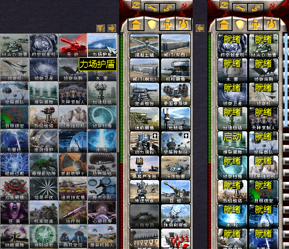


## 底栏与侧栏功能
  
### 地图缩放功能  
通过底栏的缩放按钮放大显示或扩大视野。  
你可以去除MAX档位限制来获得真全图，只是帧率可能比较低。  
```
[BottomBar]
LimitFallback=8192	; 长边上限像素 (默认8192)。0=无限制; 非0小于3820按3820; 超限钳到限制
```
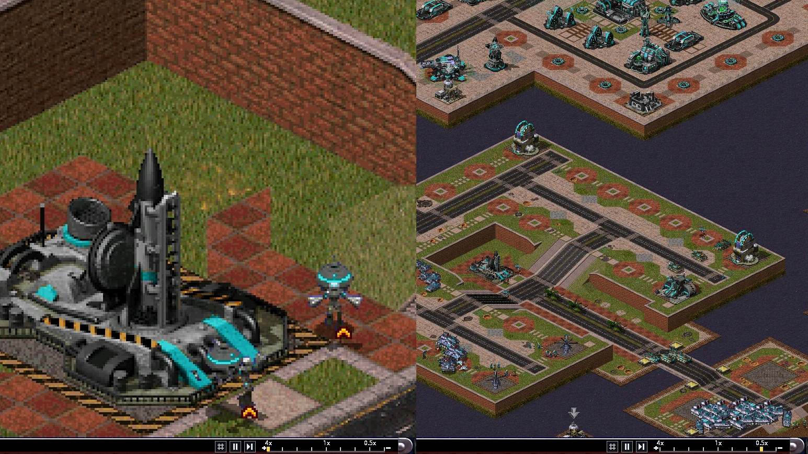

### 暂停功能  
按下F5后暂停，仅在单机生效。  
随后在底栏出现暂停和帧进按钮。  
使用F5和底栏控制随时暂停  
可以在暂停中下令，但渲染需要等待到下一帧。  
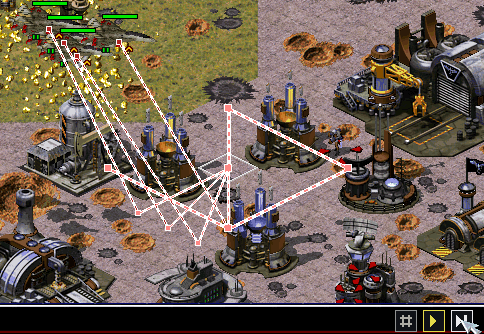

### 网格显示
按下F5时同时显示网格按钮。  img_
目前网格并非精确功能，对于红色不可达或障碍识别不正确。  
悬崖识别不可靠，但可显示阻碍建造或移动的透明覆盖物。  
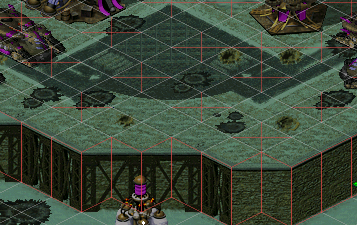

### 无UI截图功能  
底栏缩放刻度UI条左侧的相机按钮(默认隐藏，ESC 菜单 GUI 页可开启)。  
适合战役截图，取代全息截图器。  
截图不含UI，输出在Screenshots内，格式为PNG。  
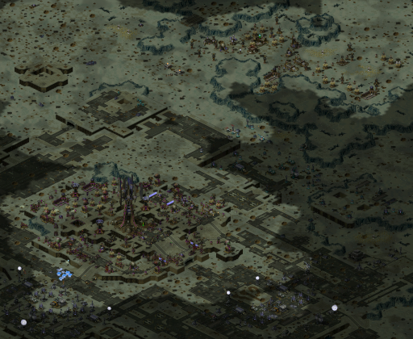


## 侧边栏功能
### 侧栏添加可拖动的滚动条
便于在侧栏列表过长时快速移动，参考图像右侧的蓝条。  
在不够长时不会显示。  
如果觉得碍眼但需要滚动条，可以单独设置宽度隐藏掉。
```
[Sidebar]
HitWidth=14			; 滚动条生效宽度 (像素, 6~20): 点击/拖动判定区
ShowWidth=6			; 滚动条显示宽度，滑块绘制宽
```


### 隐藏侧边栏
适用于小队作战或过场。  
在全显示，显示小地图和全隐藏之间切换。  
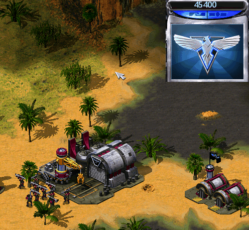

### 显示建造时间和电力消耗
在建造列表的建筑或单位上显示建造时间与消耗电量  
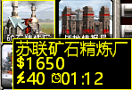


## 单位信息面板
### 查看基本信息  
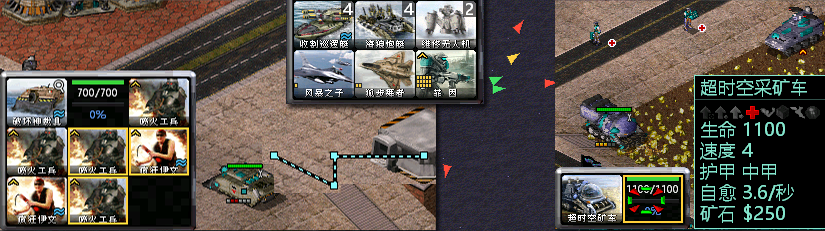     
查看弹药，升级能力，自愈，矿石等信息  
查看载具的载员，支持从多组单位中选择某一类单位  
右键点击时踢出选中成员或成员组

支持**卸载特定载员**，但在联机中禁用  

支持在载具内对成员使用路径点，且支持多选  
shift逐个点击选择多个载员，或点载具图标选中全部载员

### 单位面板侧栏
可关闭或启用部分功能  
支持折叠面板，或将升级信息持久化显示  
支持wasd模式切换，对单兵作战类有用，鸡肋玩具...   
| 单位    | 飞行器    |
| --- | --- |
|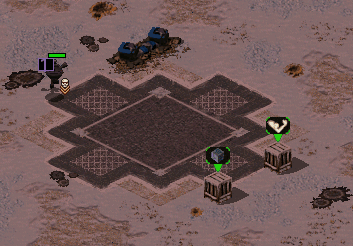|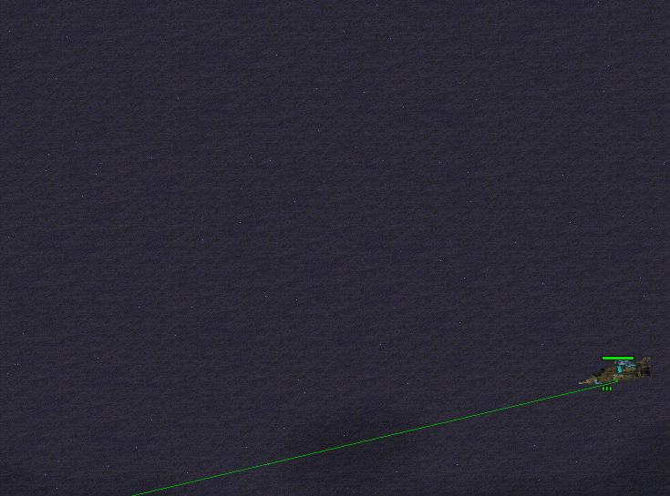|

支持收藏单位和显示箭头，也可标记通信信标位置.  
第一次点击时收藏，再次点击跳转，或者 ctrl+点击收藏，  
shift添加多个收藏，长按清除收藏  

你可以设置箭头显示在中心或屏幕边缘。  
这对于隐藏侧栏的单兵战役和查看队友信标方位有用...  
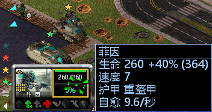  

## 小窗口
通过侧栏按钮开启。   
小窗口可以点击小地图进行位置跳转或右键移动画面。  
点击启用警报图标自动跳转最近发生的事件，与空格键跳转功能一致。  

可监控AI或远程下令：  
启用鼠标图标支持在小窗口内远程操作，比如用于致命冲击，双线操作而不切屏。  

跟随单位：   
在小窗口有焦点时，按F可无焦点跟随，包括敌人。与F跟随一致，只是取消选中也生效。  
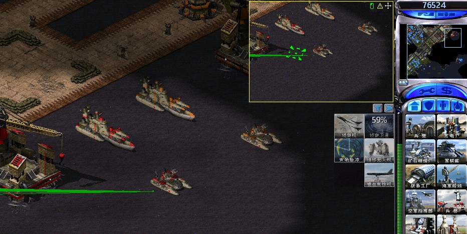

## 界面调整

### 存档缩略图
存档时也储存一份屏幕截图，易于区分游戏  
注意：如果显示错乱请更新渲染，即cnc ddraw!
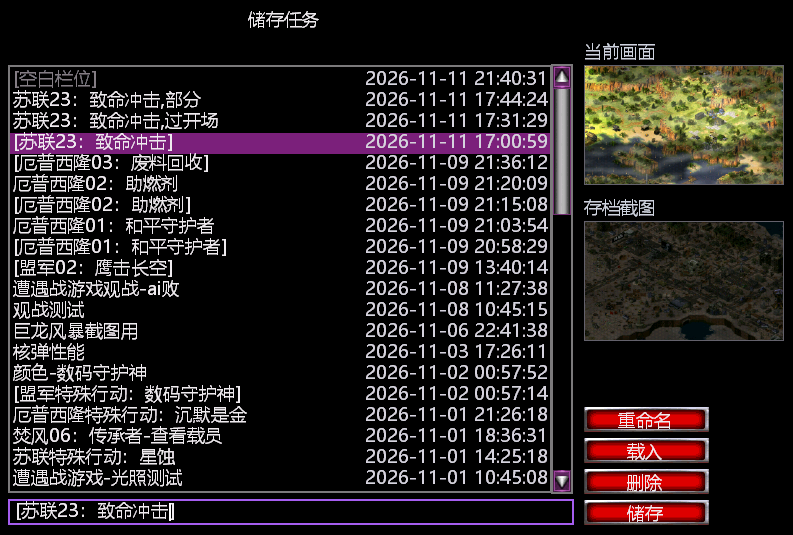

### 积分界面退出游戏
在战役结束添加退出游戏
(因继续下一关在有些战役会卡触发和状态)  
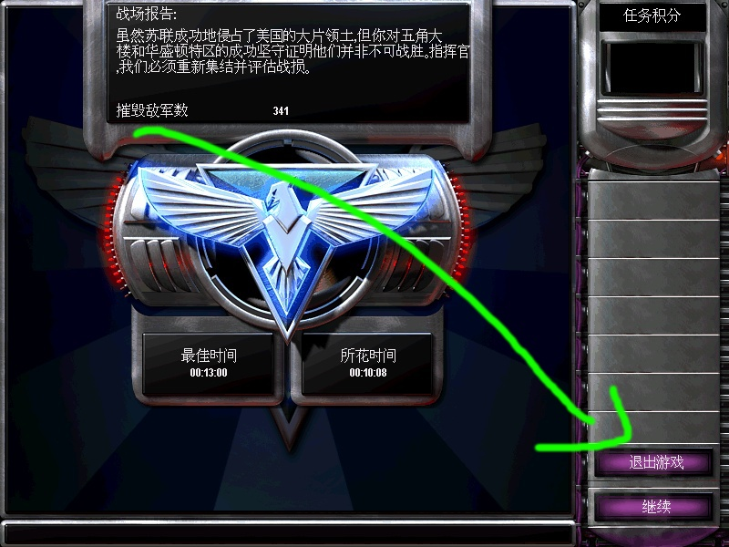

# UI文本显示优化与 BUG 修复
改进游戏内UI与文本渲染，修复一些UI BUG

## 消息列表改进 (战役文本居中显示)
将游戏内消息队列改为矢量渲染，支持设置字体，分离重要信息和次要信息的显示   
重绘战役简报文本，支持更好的显示。  
默认配置为底部居中显示，你可以修改回归左上角显示。  
鼠标放在触发区域一段时间后显示，快速掠过不显示。
```
CampBottom=0		; 1=在底部显示(底边固定, 文本向上增长), 0=顶部显示
CampBottomMargin=150; 底部模式时距底边像素
CampCentered=0		; 1=水平居中, 0=左对齐(PosX)
PosX=2				; 左上角边距
PosY=2
TopGapLines=0		; 顶部预留行数
MaxWidth=0.75		; 框宽: 整数=像素, 0=自动(半屏); 0~1小数=按屏宽百分比(如0.5); 上限=屏宽-170
```
图1：仍然可以使用左上角模式。  
图2：仍然支持打字机样式，和遵循基本消失规则，可以设置直接出现。  
图3：鼠标放在上面可以滚动查看历史文本。
<a id="假装对话"></a>
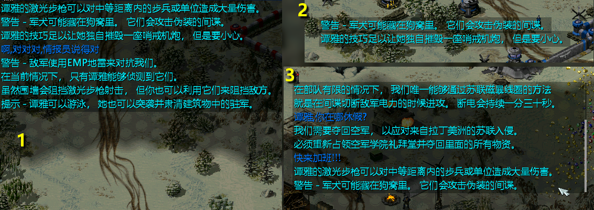 

## 输入法修复与增强
支持玩家在单机中使用聊天框，文本显示在重要信息中，[可假装与战役文本对话](#假装对话)  
支持复制、粘贴、移动光标等基础操作。  
支持设置字体、调整位置。  
通过键盘上下键切换输入历史。  
修复了输入法恒定左上角的bug，现在输入法跟随输入框。  
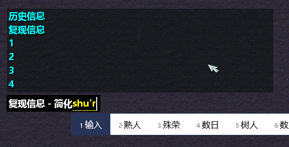   
你可以设置常用文本，在游戏中快速调用。  


## 操作与战斗提示
分离不重要的信息，也称战斗信息，操作单位不在会盖过战役文本了。  
支持单独设置，如果喜欢使用玩家色，可以该回去。(未列出全部配置)
```
HintFontFace=simsun.ttc	; 提示框字体
HintColorFollow=0	; 0=白字, 1=追随玩家实际颜色(原版色)
HintMaxLines=6		; 显示行数
HintMaxWidth=400	; 框宽像素, 0=自动
```
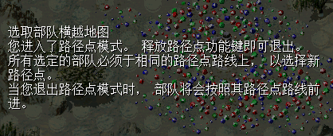

### 雷达事件跳转
对应的原版空格键事件。  
空格键对应雷达事件，上限8个，没有记录和优先级。  
现在归到左侧补全战斗信息功能，点击跳转，可查看历史。  
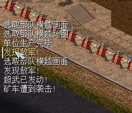

## 重绘超级武器文本列表
同样可以进行一定程度的设置。  
默认左侧原版样式。右侧展示统一面板和自定义字体。  
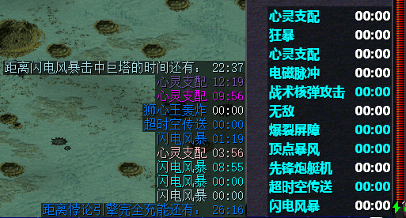

## 其它文本杂项  
尽量重绘整体其它文本为矢量字体  
这里为了让演示明显，开启了粗体。  
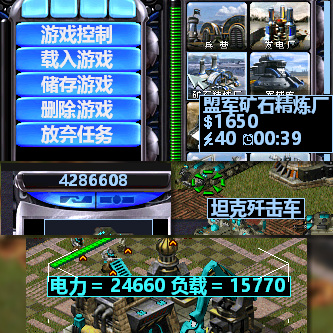  
让就绪和等待在有数字时，进行避让在左侧显示。  
  

### 战役文本重绘与修复裁剪
为了演示，使用粗体字。  
修复了文本被裁剪的问题。  
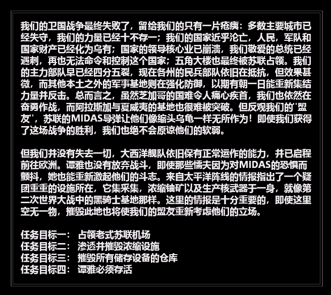

### 电量指示
底部电量指示，更直观的查看还有多少电力。  
可以设置底部居中或电量旁，可设置两种样式。  
配置文件中使用左侧样式，可以通过下面方式改为右侧样式。
```
PowerX=0			; 0=居中于侧边栏（默认）；>0=绝对x值，位于侧边栏空间内
PowerPad=0			; 屏幕底部到底端的距离，像素
PowerMode=0			; 0=负载/电力 (默认); 1=余量纯数字 (够用正数/不够负数)
```
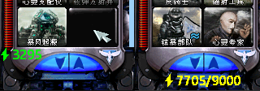  
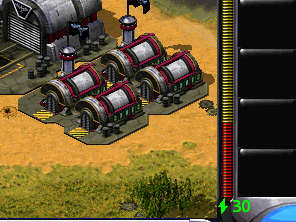
