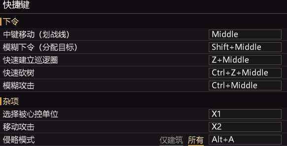
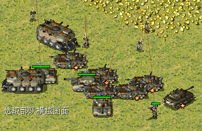
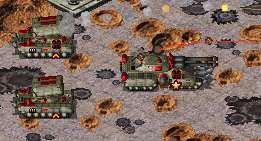
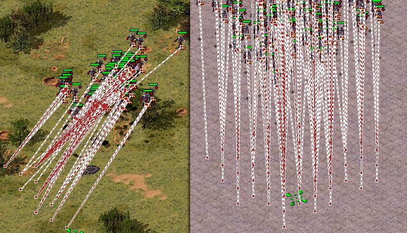
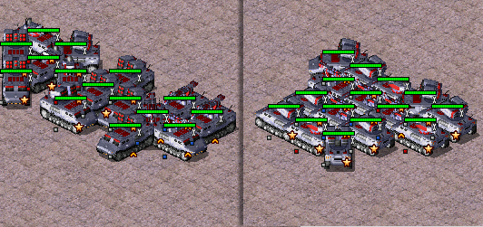
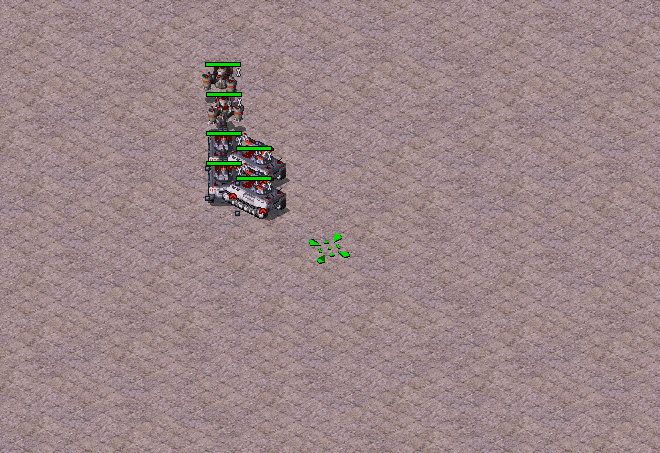
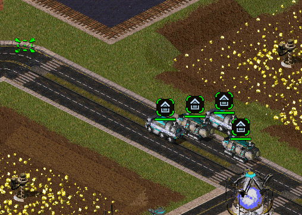
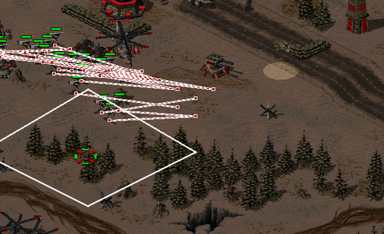
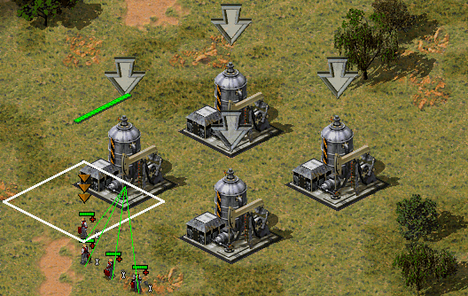
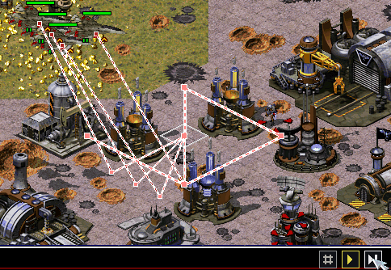

# 功能展示文档-杂项功能和模糊操作(智能中键系列)  
本文档更详细直观的介绍插件的功能。  
这篇是杂项功能和模糊操作(智能中键系列)  

## 杂项操作
### 只选中被心控单位
shift + p 单位过滤，只选中被心控单位  
与原生shift有点冲突，不太好用...  
可配置为其它快捷键，比如鼠标侧键就没有问题了  

### 简化移动攻击，自定义快捷键
简化移动攻击，允许自定义快捷键。  
目前默认设置为了鼠标侧键，可以自定义按需更改。

### 忽略不支持指令，避免乱送
左键攻击时，维修单位没有攻击能力，但会前去目标地点，这导致这类单位经常上前线送掉。  
支持左键攻击命令过滤掉维修单位，避免维修单位送死。  
中键模糊下令系列也支持。

### 简易侵略模式
使用 alt + a 让单位进入侵略模式，可用于自动攻击无伤害类建筑物。  
也可以设置为支持自动攻击其它单位，解决海军偷懒问题。  
范围使用守卫范围和武器射程中较大者。  
考虑联机兼容性，只会在单位静止时生效。  
使用小图标进行状态区分。  

## 模糊操作(智能中键系列)
后面提到的是配置文件中的快捷键。  
可自定义快捷键。

### 中键点击移动功能  
空军分散寻位，不再是大量空军使用相同目标点了。
左侧多次移动后目标点合并，单位扎堆。右侧按单位分配路径点。
  

#### 陆军聚团  
使用螺旋排列，便于铁幕之类使用。  
图中左侧普通移动，右侧中键移动。  
  

### 中键划线移动
快速简单阵型，均匀分配到画过的线上  

### 中键+Z组合 - 巡逻圈
z + 中键点击自动建立小巡逻圈，可固定飞机或维修机，不让乱跑。    
拖动划线，快速建立直线巡逻圈  
拖动划线闭合，建立遵循路径的巡逻圈  

### 展开预览和自动展开
基地车类单位展开预览占位，可自动到位展开。
单个单位中键拖动挪位置。  
多个单位时：  
考虑移动后避让展开。  
划线分配位置，自动展开，shift强制直线。  
参考图中片段:
1 自动避免重叠。 2 均匀分配。 3 支持异形预览。 4 预先避让展开单位。  
  

### 中键组合 - 快速砍树
ctrl + z + 中键。  
按住时预览伐木区域范围。  
对范围内树木和路灯等地形杂物生效，不需要点到树上。  

### 模糊下令
中键点击的目的是移动，这个是选目标。  
我不想做太多自动化，因此不会去做火力分配，不做自动最优选择。   
实现了：
快速分配和进驻建筑物。   
工程师批量维修自己建筑物。  
自适应占领空载具  
分配EP电厂和坦克碉堡  
4个一组分配目标敌人  

  

### 模糊攻击下令 
快速选择攻击目标  
ctrl+中键点击，目的是针对蜘蛛之类的难选单位。  
查看图片中期演示，按住ctr+中键自动吸附。  
  
(生态位基本被shift+中键占了，最初没计划太强...)