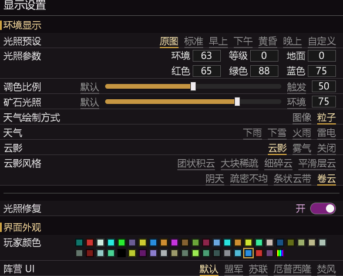
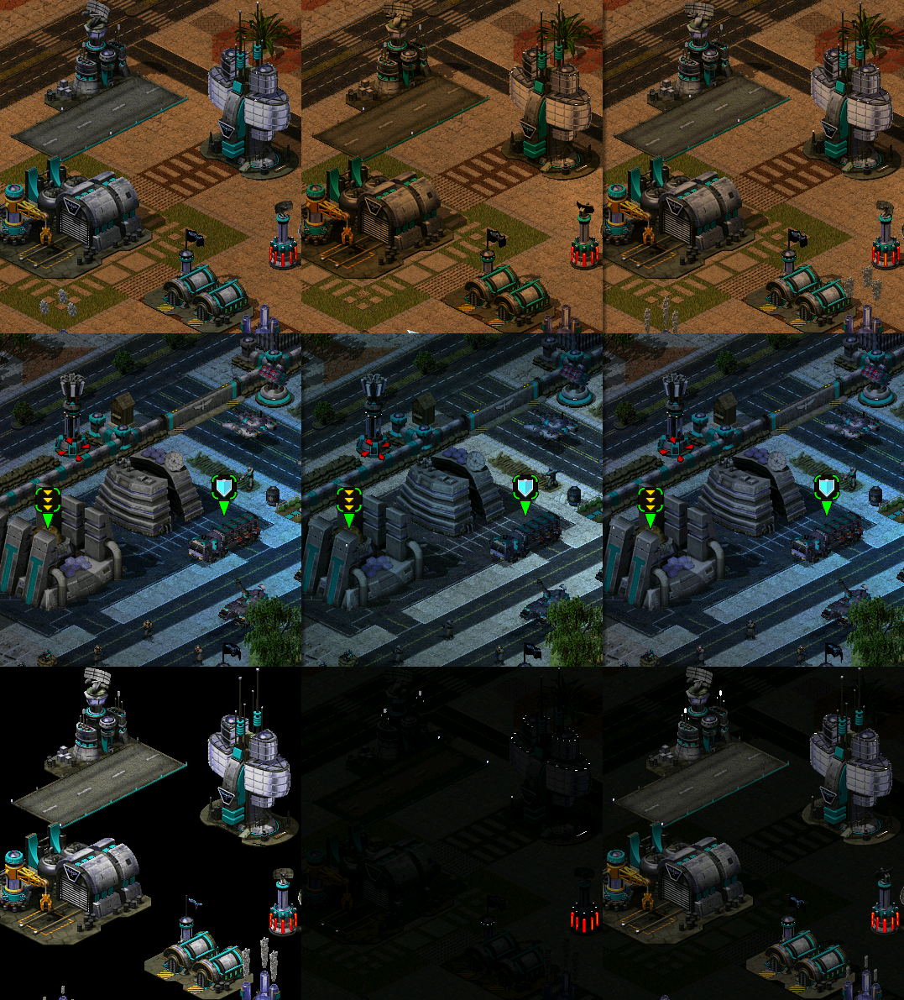
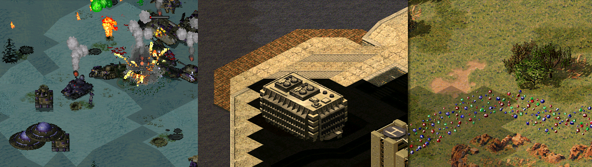
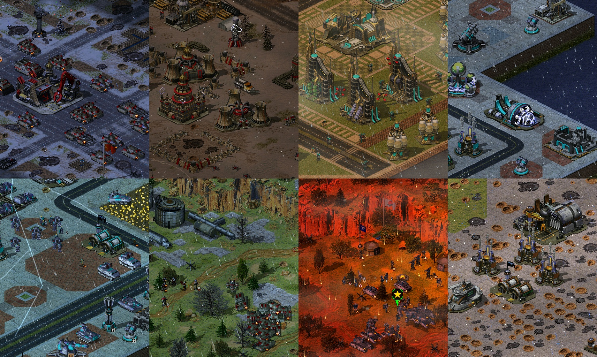
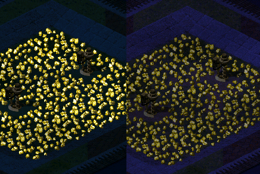
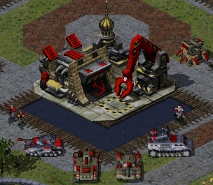

# 功能展示文档-环境控制

## 环境控制
MO的地图整体偏暗，光照平均大致在0.8。  
通过光照设置可以让过于黑的地图变亮，可以让一些阴间光照不那么阴间。  
这里的预设即地图编辑器里面的预设。  

环境：整体亮度，作用在建筑和单位上。  
等级：随高度变化改变多少亮度，可以用负数做到悬崖变黑的室内效果。  
地面：地面亮度偏移。  
红绿蓝色：即整体色调。 

### 背景知识
游戏光照其实分为两种。  
一种光照我称为"默认光照"：  
符合地图一进去就有的那种样子，单位与建筑更明显。(建筑和单位不着色,所以更明显,但在强烈光照下会存在过于突兀的问题)  
你可以把地面调黑单位调亮，或者反之调整，搞花活，灯光建筑类光照一切正常。  

另一种是"触发光照":
建筑与单位与环境融合更好，相同数值下不那么显眼。(建筑与单位着色,风格更统一,但颜色上不那么显眼,色彩范围狭窄)  
也玩不了高反差花活，灯光建筑失效，需要单独修。   
少数时候因为默认光照的花活调的不合适,触发光照才能更好。  

如图所示：
左侧是默认显眼光照，中间是氛围触发光照，丢颜色，右侧是修复+混合光照。  

### 光照修复
地面锯齿是触发光照带来的，可以重新着色修复。  

灯光类/辐射类光照画在地面上，所以触发光照就会存在问题。
修光照等于连地面颜色一块修了，这会丢一些触发带来的氛围感。  
因为修完一般是画面颜色更多更亮一些，所以与真触发色比实际有偏色。   
一般会让触发色的建筑和单位显得更暗一点(因为环境鲜艳了)。  

所以实际加了混合比例，可既有亮度又有着色，你可以在不同着色方式间切换。

### 游戏环境与天气
你可以自由更改游戏内的不合理光照，或随意做出适合截图的光照。 
添加了天气控制    
可设置贴图天气，即游戏内的下雨下雪。  
或粒子效果显示雨雪。下雨有雨声，下雪有风声，闪电有雷声

添加了云影或雾气显示，可以添加游戏氛围。  
一般可以开云影，雾气有些奇怪。 

### 矿石光照
你可以调节让矿石始终最亮显示或遵循环境显示。  
可能适用于夜间截图避免矿石太亮...   

## 界面外观
### 玩家颜色
可修改颜色，目前只对自己有效，适合摆基地截图时一人扮演多人。  

### 阵营ui
可选自己喜欢的阵营ui，也改变副官语言。  
应许愿需要，添加了触发支持和示例地图。  
