# 功能展示文档-游戏控制
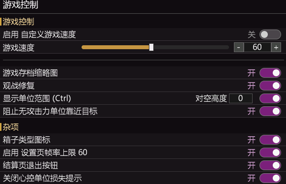

### 游戏速度控制
添加更细粒度的游戏速度控制，5帧为间隔，速度上限从60改为120，120后是无限速。  
可输入自定义帧率。  
统计方式不同，和游戏内帧率显示对不上
```
FixEngineFps=0	;修复统计帧率，统计方式不同，开启对齐显示
```
### 范围显示
显示单位一些范围。  
射击范围，最小范围、对空范围、隐形探测、间谍识别、部署武器范围。  
为了避免ui污染，需要按住ctrl对单个单位显示  

|地面|对空假设600|
| --- | --- |
| |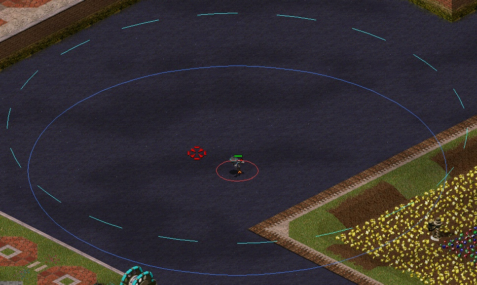|

由于空军高度不同画圆柱奇怪，因此可设假设高度  

### 箱子类型图标
添加了战役显示工具箱类型，对遭遇战的随机工具箱无效  
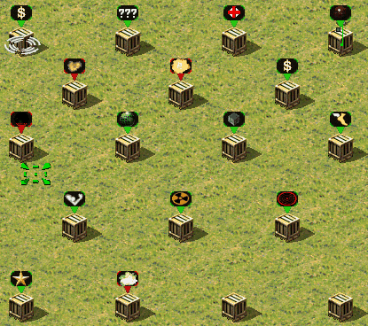

### 关闭心控单位损失提示
用于解决心控单位损失太多，提示太烦的问题。  
开启后过滤掉心控来的单位的损失提示。  
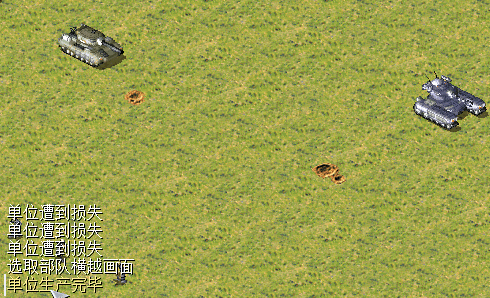

### 飞机路径点
允许飞机使用路径点。  
但考虑联机到此为止，因为移动攻击无效，而且会造成联机不同步。  
修复会造成不同步，而模拟一套伪路径点又很麻烦。  
但仍然能使用右键微移等方式强制攻击。  

你可以使用巡逻圈将飞机拴在某处，装弹完成后自动飞到巡逻圈处。  
可与中键功能搭配。(图中开始使用了快速创建巡逻圈)  
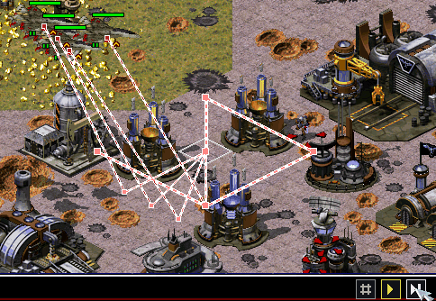

### 局部欢呼
框选单位时，按C让选中的单位进行欢呼，适用于截图录制视频...  
不选中时仍然是全图欢呼，联机禁用。

### 通讯信标调整
联机放置信标时自动删除旧信标。  
单机可以放置信标，解除了3个限制，可放置24个。
可以用来显示箭头指路...   
目前没啥用，可战未来(比如AI副官)  
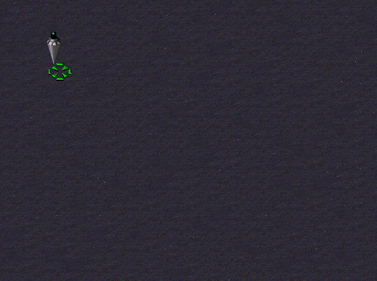
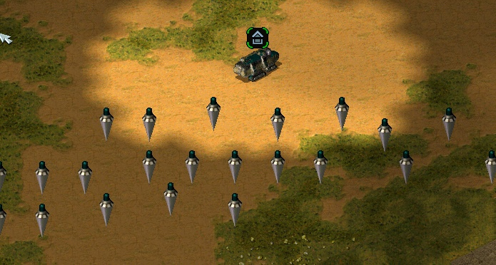

### 修复T键对建筑无法正常生效的问题
过去需要一些操作才行，现在直接生效  
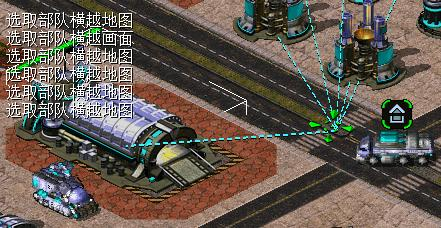

### 解除128移动和路径点限制  
单机中解除上限，联机中使用分帧下令操作，
分批下令方式实现，保险起见，联机默认禁用，可开启。
```
[Features]
OrderThrottle=1	; 大量单位下令分帧,解除128上限 (0=禁用, 与原版相同; 1=仅单机启用; 2=联机也启用)
```
解除单机路径点16上限，解除路径点总单位128上限。  
路径点联机同步，因此无法开启。  
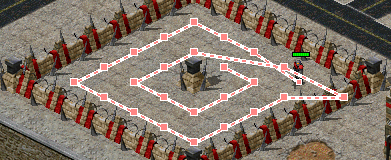

### 解除500显示后框选限制
解除了500显示后无法框选的上限，并添加查询接口。  
500是硬限制，解除就会与其它需要获取选中单位的扩展不兼容。  
注意：  
自动在phobos环境禁用。  
自动装车添加了500限制的查询能力，旧版ctrl+t同类筛选可能会崩溃，或超500后必定崩溃，新版不会。

### 修复观战逻辑
支持了单机观战显示观战面板  
支持联机下，多人观战时，其它观察者同样可显示观战面板。  
修复读档后观战失效和任意AI被击败后游戏结束  
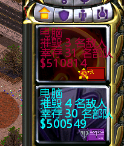 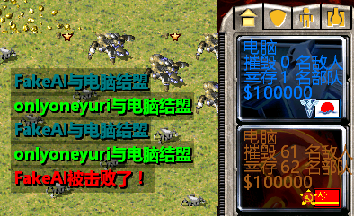

### 修复高分辨率下地图问题
当视野大于地图时，地图会来回横跳，改为居中解决高分辨率下显示问题。  
并将边缘锯齿填充为平滑直线。
这只是尽量而为，在分辨率接近情况下仍然可能存在锯齿。  
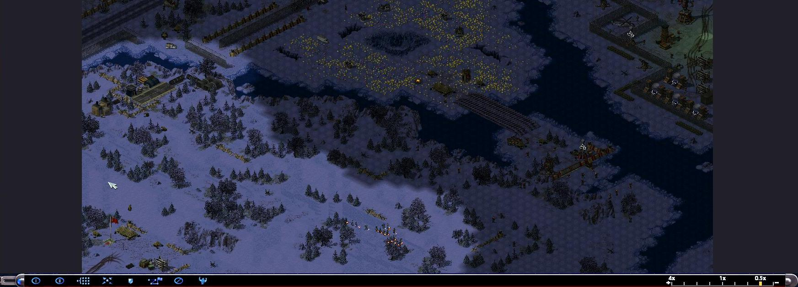

### 修复cncddraw导致设置界面占用cpu过高问题
