# 功能展示文档 1 
本文档更详细直观的介绍插件的功能。  
注：为避免篇幅太长，这里介绍演示的是UI功能示例。配置会有省略以节约空间，详细查看配置文件。

查看杂项更改与模糊下令功能：[杂项更改与模糊下令](杂项更改与模糊下令.md)

## 新增UI功能
### 超武侧栏列表
可自定义排序，将喜欢的超武放在前面。  
目前默认将力场护盾和铁幕排在前面，使用超武名称和优先级进行排序。  
可折叠，不占用空间；可隐藏防御支援页面超武，从而达到干净的防御页面。  
默认按阵营分列（盟/苏/厄/焚风各一列），可在显隐箭头上右键切换为“填充式”：排序不看阵营，各列高度尽量均衡，先两列、不够再依次加到三/四列，满四列才滚动，从而减少翻页。
```
[SWSidebar] ;配置参考，有省略。
ToggleKey=F4		; 切换显示/隐藏。隐藏时既不画也不占空间。语法见 Hotkey.md
Alpha=75			; 侧栏透明度 0~100。作用于侧栏画出的绝大多数
DedupDefensePage=1	; 原版"防御支援"页去重。1=侧栏已经显示的超武不再在原版页重复出现
MaxRows=10			; 每列最多显示几个。超出的不显示, 右侧出滚动条
FillMode=0			; 显示模式: 0=按阵营分列(默认) 1=填充式。显隐箭头上右键可实时切换
TopMargin=180		; 纵向位置，0 ~ 1比例, 0.5=垂直居中, 0.25=偏上。大于 1 = 像素
ScrollStep=1		; 滚轮每滚一格移动几行
Side=right			; 面板停靠边: right/left。盟军永远靠屏幕外缘,焚风永远靠地图内侧
; ---- 超武优先级 ----
; 负数 = 隐藏该超武;  0 或不写 = 默认显示 (优先级 1000)
; 正数 = 优先级, 数字越小越靠前。完整清单看超武列表.md
ForceShieldSpecial=1
IronCurtainSpecial=1
```
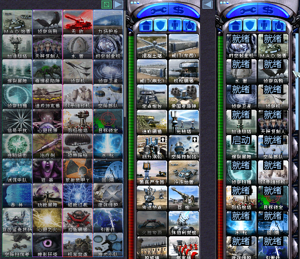

### 建筑队列
建筑建造队列，通过模拟玩家操作实现。  
不进入存档，在联机中使用会有轻微延迟。  
这是因为标准队列是联机同步的，没有延迟，而模拟玩家操作会有延迟。  
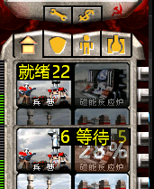

### 电量指示
底部电量指示，更直观的查看还有多少电力。  
可以设置底部居中或电量旁，可设置两种样式。  
配置文件中使用左侧样式，可以通过下面方式改为右侧样式。
```
PowerX=0			; 0=居中于侧边栏（默认）；>0=绝对x值，位于侧边栏空间内
PowerPad=0			; 屏幕底部到底端的距离，像素
PowerMode=0			; 0=负载/电力 (默认); 1=余量纯数字 (够用正数/不够负数)
```
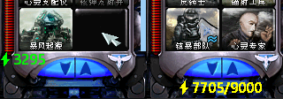  
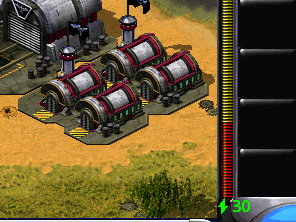
### 为侧栏添加可拖动的滚动条
便于在侧栏列表过长时快速移动，参考前面图像中右侧的蓝条。  
在不够长时不会显示。  
如果觉得碍眼但需要滚动条，可以单独设置宽度隐藏掉。
```
[Sidebar]
HitWidth=14			; 滚动条生效宽度 (像素, 6~20): 点击/拖动判定区
ShowWidth=6			; 滚动条显示宽度，滑块绘制宽
```
### 底栏与侧栏功能
**地图缩放功能**  
通过底栏的缩放按钮放大显示或扩大视野。  
你可以去除MAX档位限制来获得真全图，只是帧率可能比较低。  
```
[BottomBar]
LimitFallback=8192	; 长边上限像素 (默认8192)。0=无限制; 非0小于3820按3820; 超限钳到限制
```
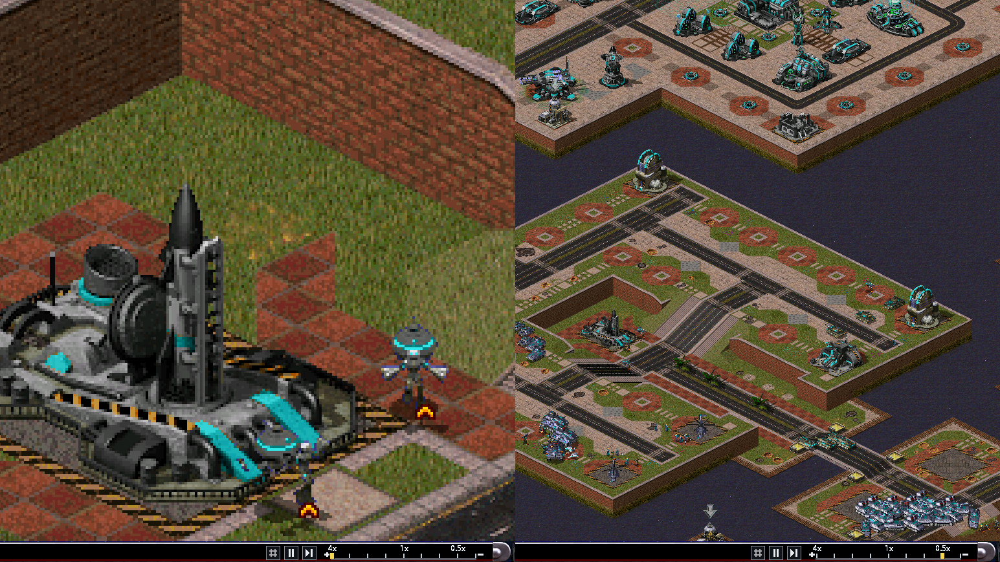
**暂停功能 & 网格显示**  
按下F5后暂停，仅在单机生效。  
随后在底栏出现暂停和帧进按钮。  
使用F5和底栏控制随时暂停  
可以在暂停中下令，但渲染需要等待到下一帧。  
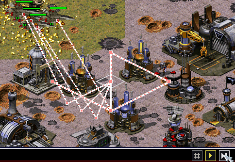

按下F5时同时显示网格按钮。  
目前网格并非精确功能，对于红色不可达或障碍识别不正确。  
悬崖识别不可靠，但可显示阻碍建造或移动的透明覆盖物。  
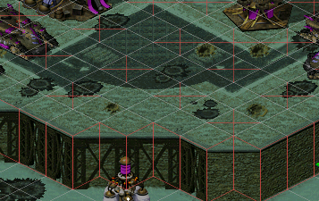

### 隐藏侧栏
在全显示，显示小地图和全隐藏之间切换。  
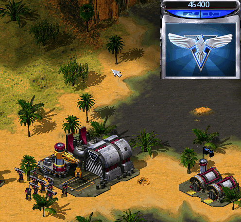

### 范围显示
显示单位一些范围。  
射击范围，最小范围、对空范围、隐形探测、间谍识别、部署武器范围。  
为了避免ui污染，需要按住ctrl对单个单位显示  
.png>)


## UI 优化 与 BUG 修复
改进游戏内UI与文本渲染，修复一些UI BUG
### 消息列表改进 (战役文本居中显示)
将游戏内消息队列改为矢量渲染，支持设置字体，分离重要信息和次要信息的显示   
重绘战役简报文本，支持更好的显示。  
默认配置为底部居中显示，你可以修改回归左上角显示。  
鼠标放在触发区域一段时间后显示，快速掠过不显示。
```
CampBottom=0		; 1=在底部显示(底边固定, 文本向上增长), 0=顶部显示
CampBottomMargin=150; 底部模式时距底边像素
CampCentered=0		; 1=水平居中, 0=左对齐(PosX)
PosX=2				; 左上角边距
PosY=2
TopGapLines=0		; 顶部预留行数
MaxWidth=0.75		; 框宽: 整数=像素, 0=自动(半屏); 0~1小数=按屏宽百分比(如0.5); 上限=屏宽-170
```
图1：仍然可以使用左上角模式。  
图2：仍然支持打字机样式，和遵循基本消失规则，可以设置直接出现。  
图3：鼠标放在上面可以滚动查看历史文本。
<a id="假装对话"></a>
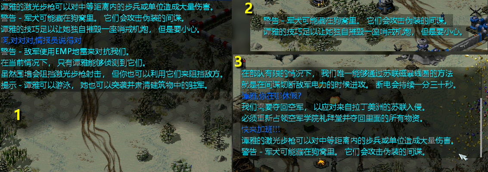 

分离不重要的信息，也称战斗信息，操作单位不在会盖过简报了。  
支持单独设置，如果喜欢使用玩家色，可以该回去。(未列出全部配置)
```
HintFontFace=simsun.ttc	; 提示框字体
HintColorFollow=0	; 0=白字, 1=追随玩家实际颜色(原版色)
HintMaxLines=6		; 显示行数
HintMaxWidth=400	; 框宽像素, 0=自动
```
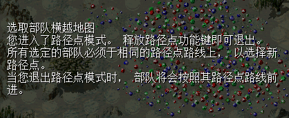

### 输入法修复与增强
支持玩家在单机中使用聊天框，文本显示在重要信息中，[可假装与战役文本对话](#假装对话)  
支持复制、粘贴、移动光标等基础操作。  
支持设置字体、调整位置。  
通过键盘上下键切换输入历史。  
修复了输入法恒定左上角的bug，现在输入法跟随输入框。  
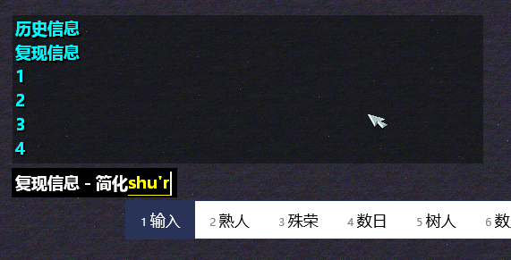

### 重绘超级武器文本列表
同样可以进行一定程度的设置。  
默认左侧原版样式。右侧展示统一面板和自定义字体。  
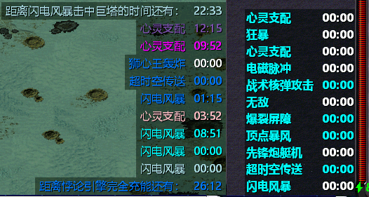

### 战役文本重绘与修复裁剪
为了演示，使用粗体字。  
修复了文本被裁剪的问题。  
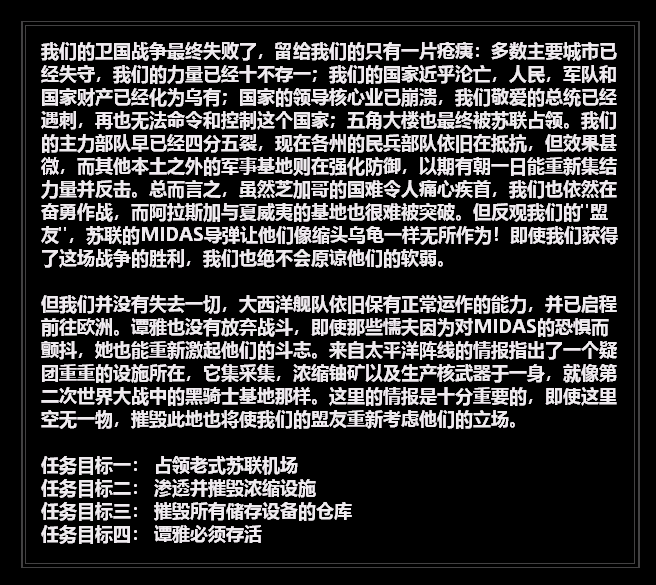

### 其它杂项  
尽量重绘整体其它文本为矢量字体  
这里为了让演示明显，开启了粗体。  
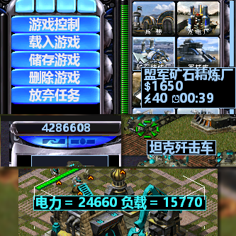  
让就绪和等待在有数字时，进行避让在左侧显示。  
  
**显示建造时间和电力消耗**  
在建造列表的建筑或单位上显示建造时间与消耗电量
参考前面图像  

### 修复观战逻辑
支持了单机观战显示观战面板  
支持联机下，多人观战时，其它观察者同样可显示观战面板。  
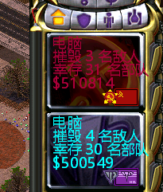 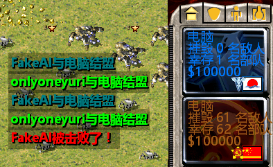

### 修复高分辨率下地图问题
当视野大于地图时，地图会来回横跳，改为居中解决高分辨率下显示问题。  
并将边缘锯齿填充为平滑直线。
这只是尽量而为，在分辨率接近情况下仍然可能存在锯齿。  
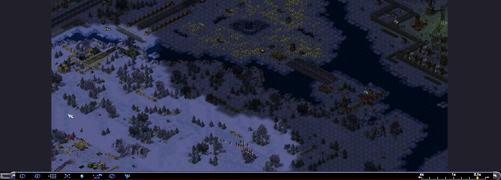

### 雷达事件跳转
对应的原版空格键事件。  
空格键对应雷达事件，上限8个，没有记录和优先级。  
现在归到左侧补全战斗信息功能，点击跳转，可查看历史。  
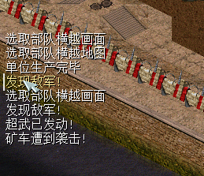