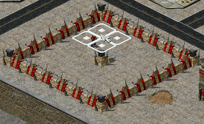
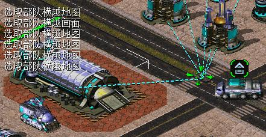
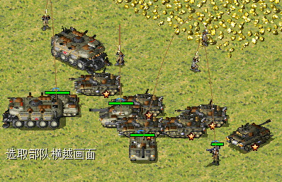
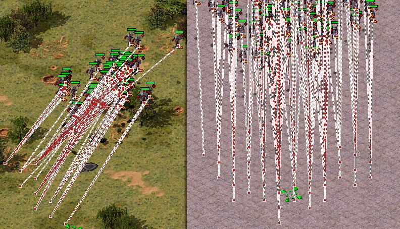
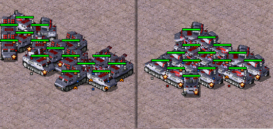
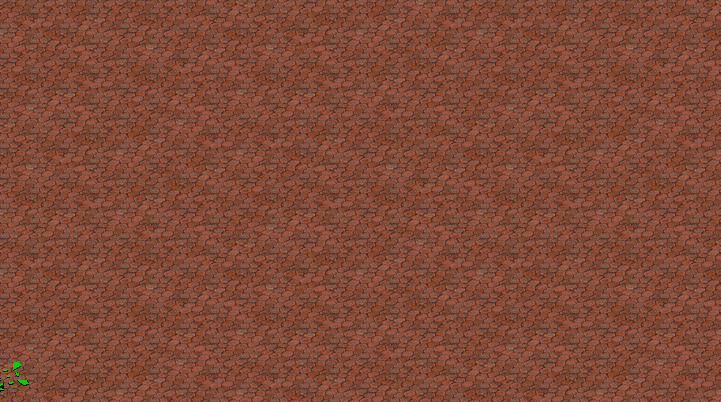
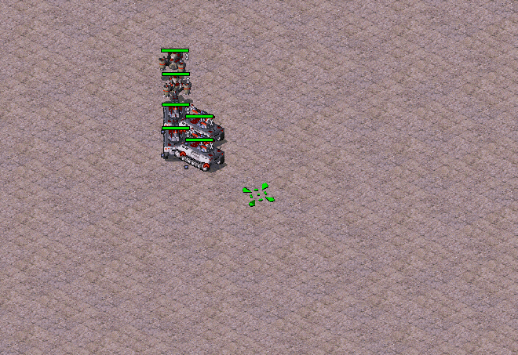
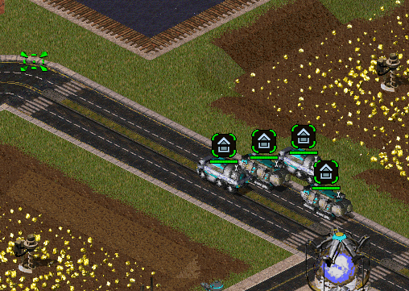
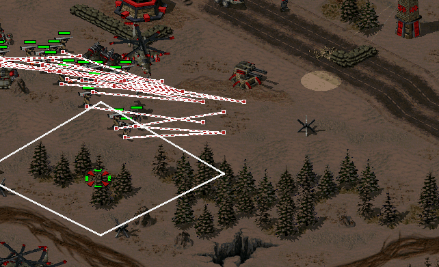
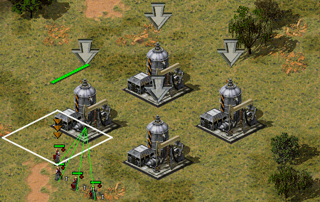

# 功能展示文档 2
本文档更详细直观的介绍插件的功能。  
这篇是UI外的杂项功能和模糊操作(智能中键系列)  

许多杂项功能算进了ui里面，在那里查看更多功能。[功能展示-UI篇](功能展示-UI篇.md)

## 杂项功能
### 建造时驱赶单位
分为自动驱逐和手动驱逐。  
如果你使用快捷键放置建筑，那么可以用自动驱逐。  
如果你不想被意外驱逐单位，那么可以用手动驱逐。
```
[PlaceScatter]
Mode=1		; 0=禁用(原版行为), 1=点下时驱离(默认, 晃幽影不碰单位), 2=幽影跟随自动驱离
Interval=30	; Mode=2 补扫间隔 (游戏逻辑帧, 5~300, 默认30)
Batch=16	; 每次触发最多发出的移动事件 (1~64, 默认16)
Dist=2		; 出框后再向外推的格数 (1~4, 默认2)
```


### 飞机路径点
允许飞机使用路径点。  
但考虑联机到此为止，因为移动攻击无效，而且会造成联机不同步。  
修复会造成不同步，而模拟一套伪路径点又很麻烦。  
但仍然能使用右键微移等方式强制攻击。  

你可以使用巡逻圈将飞机拴在某处，装弹完成后自动飞到巡逻圈处。  
可与中键功能搭配。(图中开始使用了快速创建巡逻圈)  


### 修复T键对建筑无法正常生效的问题
过去需要一些操作才行，现在直接生效  


### 解除128移动限制
分批下令方式实现，保险起见，联机默认禁用，可开启。
```
[Features]
OrderThrottle=1	; 大量单位下令分帧,解除128上限 (0=禁用, 与原版相同; 1=仅单机启用; 2=联机也启用)
```

### 只选中被心控单位
shift + p 单位过滤，只选中被心控单位  
与原生shift冲突，不太好用...  
可配置为其它快捷键  


### 简化建筑维修
默认启用的是快速维修，不是自动维修。  
Ctrl+维修 或 双击维修。  
快捷键或界面按钮均可。  
也支持自动维修。  
扩展中做了维修过滤，不能维修其它不该被维修的东西。  

### 简化移动攻击，自定义快捷键
简化移动攻击，允许自定义快捷键。  
目前默认设置为了鼠标侧键，可以自定义按需更改。

## 模糊操作(智能中键系列)
后面提到的是配置文件中的快捷键。  
可自定义快捷键。

### 中键点击移动功能  
空军分散寻位，不再是大量空军使用相同目标点了。
左侧多次移动后目标点合并，单位扎堆。右侧按单位分配路径点。
  

陆军聚团  
使用螺旋排列，便于铁幕之类使用。  
左侧普通移动，右侧中键移动。  
  

### 中键划线移动
快速简单阵型，均匀分配到画过的线上  


### 中键+Z组合 - 巡逻圈
z + 中键点击自动建立小巡逻圈，可固定飞机或维修机，不让乱跑。    
拖动划线，快速建立直线巡逻圈  
拖动划线闭合，建立遵循路径的巡逻圈  


### 展开预览和自动展开
基地车类单位展开预览占位，可自动到位展开。
单个单位中键拖动挪位置。  
多个单位时：  
考虑移动后避让展开。  
划线分配位置，自动展开，shift强制直线。  
参考图中片段:
1 自动避免重叠。 2 均匀分配。 3 支持异形预览。 4 预先避让展开单位。  
  

### 中键组合 - 快速砍树
ctrl + z + 中键。  
按住时预览伐木区域范围。  
对范围内树木生效，不需要点到树上。  


### 模糊攻击下令
快速选择攻击目标
ctrl+中键点击，目的是针对蜘蛛之类的难选单位。  
查看图片中期演示，按住ctr+中键自动吸附。  
  

### 模糊下令
中键点击的目的是移动，这个是选目标。  
  
快速自动选择目标，目前绑定在鼠标侧键上，因为与计划的shift冲突  